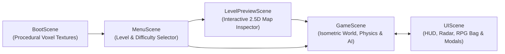

# System Architecture (`docs/architecture.md`)

## 1. Scene Flow

## 2. Coordinate & Projection System

- **Grid Space**: `(gx, gy, gz)` where `gx` is column (`0 .. gridWidth-1`), `gy` is row (`0 .. gridHeight-1`), and `gz` is vertical elevation in voxel units.
- **Isometric Screen Projection**:
  - `isoX = (gx - gy) * (tileWidth / 2)` (`tileWidth = 64`)
  - `isoY = (gx + gy) * (tileHeight / 2) - (gz * elevationStep)` (`tileHeight = 32`, `elevationStep = 18`)
- **Depth Sorting**: Sprites and tiles sort by isometric baseline `y` plus layer offsets so elevated blocks, platforms, characters, and obstacles occlude properly.

